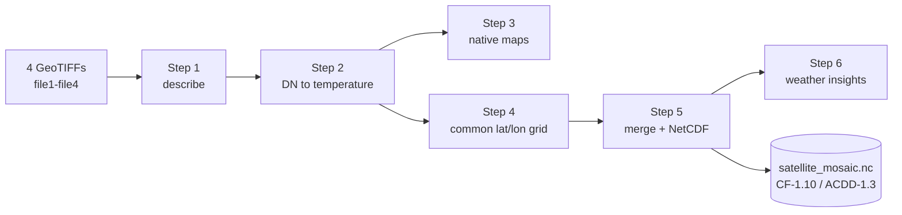

# Satellite data processing challenge: solution

This README answers the seven tasks of the challenge. The original brief is at the end.

Four satellite images go in. A documented NetCDF file and a set of figures come out. The code is six Python scripts, one per task, run in order.



## How to run

```bash
python -m venv .venv
.venv/bin/pip install --only-binary :all: -r requirements.txt
.venv/bin/python -m src.run_all        # all steps, about 2.5 minutes
.venv/bin/python -m src.step3_maps     # or a single step
```

Each step only reads the outputs of earlier steps. If cartopy cannot download the coastlines, run `export SSL_CERT_FILE=$(python -m certifi)` first.

The NetCDF files are not in the repository (the merged file is 149 MB). Run the pipeline to create them.

## Code

| File | Lines | What it does |
|---|---|---|
| `src/common.py` | 138 | All settings (file identities, no-data rules, grid, calibration anchors) and shared helpers |
| `src/step1_describe.py` | 61 | Format, projection, size, time and coverage of each file |
| `src/step2_calibrate.py` | 138 | 8-bit values to brightness temperature, histograms, file4 channel decoding |
| `src/step3_maps.py` | 91 | One map per file in its own projection |
| `src/step4_reproject.py` | 86 | All files on one 0.03° lat/lon grid |
| `src/step5_merge.py` | 187 | IR mosaic and all inputs in one CF/ACDD NetCDF file |
| `src/step6_weather.py` | 192 | Weather insights from the NetCDF file |
| `src/run_all.py` | 19 | Runs the six steps in order |

## Outputs

| Folder | Content |
|---|---|
| `outputs/step1_files/` | `files.md`: table describing the four files |
| `outputs/step2_calibration/` | `calibration.json` (calibration line and anchors, read by steps 3, 4 and 5) and three figures |
| `outputs/step3_maps/` | One map per file |
| `outputs/step4_reprojected/` | One NetCDF per file on the common grid (not committed) and an overview figure |
| `outputs/step5_merged/` | `satellite_mosaic.nc` (not committed) and `composite.png` |
| `outputs/step6_weather/` | `weather.json` (all numbers below) and three figures |

## 1. File description

| | file1 | file2 | file3 | file4 |
|---|---|---|---|---|
| Satellite | Meteosat (MSG), 0° | Himawari-9, 140.7°E | GOES-East, 75°W | Polar orbiter |
| Instrument | SEVIRI | AHI | ABI | AVHRR type |
| Channel | IR 10.8 µm | IR 10.4 µm | Water vapour 6-7 µm | RGB: VIS 0.6, NIR 0.8, inverted IR 10.8 µm |
| Projection | Lat/lon (equidistant cylindrical) | Lat/lon (equidistant cylindrical) | Geostationary | Polar stereographic |
| Pixel size | 3.0 km | 2.0 km | 2.0 km | 1.15 x 1.0 km |
| Size (pixels) | 5666 x 5936 | 8500 x 8906 | 5424 x 5424 | 2560 x 2088 |
| Time (UTC) | 2025-01-22 06:15 | 2025-01-22 08:00 | Not given | 2025-01-20 12:19 |
| Valid pixels | 87 % | 94 % | 78 % | 83 % |

All four files are 8-bit GeoTIFFs (values 0-255). They are display images, not calibrated satellite data: they have no units, no calibration and almost no metadata.

How the satellites were identified:

- **Position:** a geostationary disc is symmetric around the satellite longitude. The disc edges give 0.6° for file1 and 140.7°E for file2.
- **Pixel size:** ABI samples every 56 µrad, which is 2.004 km from geostationary height. This matches file3 exactly (2004 m). file1 keeps the SEVIRI sampling distance of 3.0004 km.
- **Time:** from the TIFF time tag. file3 has none.

Full table: `outputs/step1_files/files.md`.

## 2. Data extraction

- **No-data values.** 0 in file1 and file2, the alpha band in file4. In file3, 255 marks space but also the coldest (saturated) storm tops, so only 255 regions that touch the image border are treated as no data.
- **Projection fix.** GOES scans along the x axis (`sweep=x`). GeoTIFF cannot store this, so file3 falls back to the Meteosat convention and pixels shift by kilometres near the disc edge. With `sweep=x` the coastlines fit.
- **Temperature.** The IR values decrease linearly with temperature. A weighted fit through scenes of known temperature (clear ocean, coldest tropical storm tops) gives

  **BT = 329.0 - 0.568 x DN (K), uncertainty ±5 K**

  Three other scenes (Antarctic plateau, Sahara before sunrise, central Australia in the afternoon) confirm it. The images cover about 184 to 329 K. One DN step is 0.57 K.
- **file4 channels.** Red and green fade where the sun sets, so they are reflected-light channels (VIS 0.6 and NIR 0.8 µm). Blue does not depend on the sun, so it is thermal IR, inverted (cold is bright).

Figures: `outputs/step2_calibration/`.

## 3. Visualisation

One map per file in its own projection, with coastlines and gridlines. IR is shown in kelvin: grey for warm surfaces and low cloud, purple for cloud tops colder than 235 K (ice clouds). Water vapour goes from dark (dry) to white (moist or high cloud).

Figures: `outputs/step3_maps/`.

## 4. Reprojection

- **Grid:** EPSG:4326 at 0.03° (about 3.3 km, close to the SEVIRI resolution), 6000 x 12000 cells.
- **Resampling:** area average, so the coarser grid keeps the mean value and avoids aliasing. No-data pixels are excluded.
- **Date line:** file2 crosses 180°, so it is reprojected in two parts.
- **Coverage of the grid:** file1 33.0 %, file2 35.7 %, file3 36.1 %, file4 1.3 %.

Figure: `outputs/step4_reprojected/all_files_on_grid.png`.

## 5. Merging

`outputs/step5_merged/satellite_mosaic.nc` follows the CF-1.10 and ACDD-1.3 conventions. It contains:

- every input as its own variable (IR in kelvin, the other files as relative levels),
- an IR mosaic (`toa_brightness_temperature`) that takes each pixel from the satellite with the smallest viewing angle,
- for each mosaic pixel: the source satellite, the scan time and the viewing angle.

The mosaic covers 76.9 % of the globe. Meteosat and Himawari meet at 70.4°E, where both see the Earth at about 79°. The two images are 1 h 45 min apart, so the clouds do not match exactly at this seam.

Figure: `outputs/step5_merged/composite.png`.


## 6. Weather insights

All temperature thresholds were also tested at ±5 K (the calibration uncertainty).

| Topic | Result | Explanation |
|---|---|---|
| Land vs ocean | Land minus ocean: -8.5 K in the Sahara before sunrise, +1.2 K in Arabia mid-morning, +8.5 K in southern Africa in the morning, +26.9 K in Australia late in the afternoon | Land heats and cools much faster than the ocean. The difference follows the local time of day |
| Tropical rain belt (ITCZ) | Atlantic 4.9°N, Indian Ocean 7.3°S, Maritime Continent 4.8°N | Over the Atlantic the belt stays north of the equator all year. Over the Indian Ocean it moves south in January. Africa and the West Pacific have two bands of similar strength, so their peak depends on the threshold |
| Large storm systems | 12 systems with the size of a mesoscale convective complex (9 to 16 within ±5 K). The largest is 2.5 million km² near 1°N 108°E, west of Borneo, with tops at 187 K | Tops at 187 K are near or above the tropical tropopause. With one image the 6 h duration cannot be checked, so these are MCC-sized systems, not confirmed MCCs |
| Cold-air outbreak (file4) | Open cells between Iceland and the Faroes, typical size about 19 km | Arctic air over a warmer sea. The size comes from the spatial spectrum of the visible channel |
| False detections | Large "cold cloud" areas over Siberia, Greenland and Antarctica | Cold winter ground seen at viewing angles above 80°. Excluded from the storm statistics |

Figures and numbers: `outputs/step6_weather/`.

## 7. Summary

**Key observations**

- The files are display images, so physical values had to be recovered before any analysis.
- The scene is typical for January: tropical convection moved into the southern summer over land and the Indian Ocean, a winter storm track in the North Atlantic, and a cold-air outbreak over the Norwegian Sea.

**Challenges**

- No calibration in the files. Solved with known-temperature scenes and checked against independent scenes.
- Wrong projection in file3 (missing sweep axis). Found by checking coastlines.
- The value 255 in file3 means both space and saturated storm tops. Solved with the border rule.
- file2 crosses the date line. Solved by reprojecting it in two parts.
- The global grid does not fit in memory at once. Solved with chunked processing (dask).
- Two satellites seen at different times and very oblique angles at the seam. Documented per pixel in the NetCDF (source, time, angle).

**Results**

- One reproducible pipeline, from the raw files to a documented NetCDF file.
- Maps of each file, the merged product and four weather analyses with tested thresholds.

## Limitations and next steps

- Temperatures are ±5 K. The three check scenes all come out 2-5 K too cold, so the line may have a small cold bias. With Level 1 data (calibrated radiances) this step is not needed.
- One channel per satellite: no cloud phase, fog, dust or snow detection.
- One image per satellite: no motion, winds or storm tracking.
- The water-vapour image has no time and no calibration.
- No parallax correction: high clouds seen at large angles are shifted (about 77 km for a 15 km cloud top at the seam).
- Next steps: add Meteosat IODC (45.5°E) and GOES-West to close the gaps, use same-time images, correct parallax, and track storms over time.

---

# Original challenge brief

## Overview
This repository addresses a challenge centered around satellite data processing. The objective is to process provided satellite data files, extract useful information, and create meaningful visual and analytical outputs.

## Challenge Tasks

### 1. File Description
- Analyze and describe the contents of the provided files:
  - `file1`
  - `file2`
  - `file3`
  - `file4`

### 2. Data Extraction
- Extract as much information as possible from the provided files. This includes:
  - Metadata (e.g., projection, resolution, timestamp, etc.)
  - Raster or vector data specifics

### 3. Visual Representation
- Generate meaningful image representations of the data, such as:
  - Heatmaps
  - Topographic maps
  - Any other visualization relevant to the data context

### 4. Reprojection
- Reproject all images to a common projection system for consistency.

### 5. Data Merging
- Merge the data from all compatible files into a single comprehensive image, ensuring alignment and consistency.

### 6. Weather Insights
- If possible, extract and provide useful weather-related information from the data.

### 7. Summary
- Summarize the work performed, including:
  - Key observations
  - Challenges encountered
  - Results achieved

## Requirements

### Programming Language
- **Python**

### Suggested Libraries
- [osgeo (gdal, osr)](https://gdal.org/): For handling geospatial data
- [numpy](https://numpy.org/): For numerical operations
- [rasterio](https://rasterio.readthedocs.io/): For raster data manipulation
- [matplotlib](https://matplotlib.org/): For creating visualizations

## Instructions
1. Clone this repository:
   ```bash
   git clone https://github.com/StormGeo/dataops-challenge-satellite
   ```
2. Push the changes to your personal GitHub account:
   - Create a new repository in your personal GitHub account.
   - Push the cloned repository to your personal repository:
     ```bash
     git remote add origin https://github.com/your-username/your-repo-name.git
     git push -u origin main
     ```
4. Add me as a participant in your repository to review the results:
   - Go to your repository on GitHub.
   - Navigate to **Settings** > **Manage Access**.
   - Add my GitHub username as a collaborator: manelceperuelo

5. You will present the results in the second-round interview. Be prepared to discuss:
   - Your approach to solving the tasks
   - Challenges encountered
   - Tools and methods used

## Notes
- The provided images may be in different projections, requiring careful handling during reprojection and merging.
- The final outputs should include both visual and textual summaries to demonstrate the results.

## Deliverable suggestions
1. Descriptions of the files
2. Image representations
3. Reprojected images
5. Merged images
6. Weather-related insights (if applicable)
7. A summary of the work

## Questions?
You are free to organize and structure the project and the code as you see fit.
If you have any questions, please contact us and we'll help you out. This is not an exam.

---

Happy coding and good luck with the challenge!
