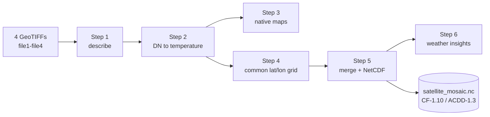
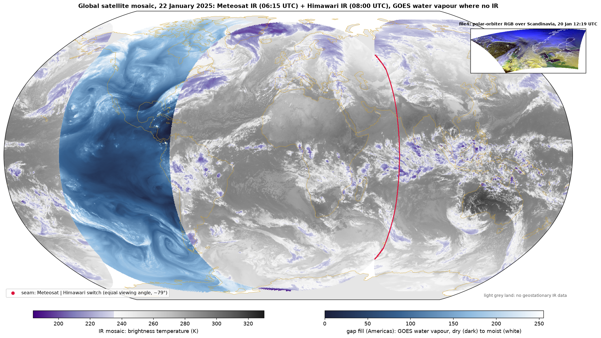

# Satellite data processing challenge: solution

This README answers the seven tasks of the challenge. The original brief is at the end. During the course of this exercise, I have made some consultation to AI (Claude) which has helped me, I have highlighted in what AI has assisted me.

Four satellite images go in. A documented NetCDF file and a set of figures come out. The code is six Python scripts, one per task, run in order.



## Approach

| Step | What I did | Why |
|---|---|---|
| 1. Describe | Read format, projection, size, time and valid area of each file | Every later step depends on knowing what each file is |
| 2. Extract | Defined the no-data rules, fixed one projection and converted 8-bit values to temperature | Without physical units there is no meteorology |
| 3. Visualise | Mapped each file in its own projection with coastlines | Cheapest check that the georeferencing is correct, before any resampling |
| 4. Reproject | Put all files on one lat/lon grid (EPSG:4326, 0.03°) | Files can only be compared and merged on the same grid |
| 5. Merge | Built one IR mosaic and wrote everything to one CF/ACDD NetCDF file | One self-describing file that any tool can read |
| 6. Weather | Extracted weather information from the merged product | To show what the data says about the weather of that day |

## How to run

```bash
python -m venv .venv
.venv/bin/pip install --only-binary :all: -r requirements.txt
.venv/bin/python -m src.run_all        # all steps, about 2.5 minutes
.venv/bin/python -m src.step3_maps     # or a single step
```

Each step only reads the outputs of earlier steps.

The NetCDF files are not in the repository. GitHub rejects any file over 100 MB, and the merged NetCDF is 149 MB.  Run the pipeline to create them again.

## 1. File description

| | file1 | file2 | file3 | file4 |
|---|---|---|---|---|
| Satellite | Meteosat (MSG), 0° | Himawari-9, 140.7°E | GOES-East, 75°W | Polar orbiter |
| Instrument | SEVIRI | AHI | ABI | AVHRR type |
| Channel | IR 10.8 µm | IR 10.4 µm | Water vapour 6-7 µm | RGB: VIS 0.6, NIR 0.8, inverted IR 10.8 µm |
| Projection | Lat/lon (equidistant cylindrical) | Lat/lon (equidistant cylindrical) | Geostationary | Polar stereographic |
| Pixel size (estimated using code made by AI) | 3.0 km | 2.0 km | 2.0 km | 1.15 x 1.0 km |
| Size (pixels) | 5666 x 5936 | 8500 x 8906 | 5424 x 5424 | 2560 x 2088 |
| Time (UTC) | 2025-01-22 06:15 | 2025-01-22 08:00 | Not given | 2025-01-20 12:19 |
| Valid pixels | 87 % | 94 % | 78 % | 83 % |

All four files are 8-bit GeoTIFFs (values 0-255). They are display images, not calibrated satellite data: no units, no calibration, no channel names.

**How I identified the satellites.** The metadata does not name any satellite. It only contains the projection and, for three files, a timestamp.

- **file3:** The projection itself is the evidence. It is geostationary, centred at 75°W at 35 786 km, which is the GOES-East position. After consulting with AI, as I was not fully trusting my notes and memory, I confirmed it with the pixel size: ABI samples every 56 µrad, which is 2.004 km at that height, and the file has 2004 m pixels.
- **file1, file2 and file4:** The projection is a plain lat/lon or polar stereographic grid. First I identified the centre of the disc from the symmetry of its edges (0.6° for file1, 140.7°E for file2) and consulted AI (Claude) with these centres and the timestamps to identify the satellites. file1 keeps the SEVIRI sampling distance (3.0004 km), which is consistent with Meteosat. For file4 only the instrument type is certain (AVHRR-like channels); the exact satellite is not.

Full table: `outputs/step1_files/files.md`.

## 2. Data extraction

- **No-data values.** 0 in file1 and file2, the alpha band in file4. In file3, 255 marks space but also the coldest (saturated) storm tops, so only 255 regions that touch the image border are treated as no data.
- **Projection fix.** GOES scans along the x axis (`sweep=x`). GeoTIFF cannot store this, so file3 falls back to the Meteosat convention and pixels shift by kilometres near the disc edge. With `sweep=x`, the coastlines fit. I solved this with the help of AI after reviewing my Remote Sensing notes, combining old and new methods.
- **Temperature.** The IR values decrease linearly with temperature. A weighted fit through scenes of known temperature (clear ocean, coldest tropical storm tops) gives

  **BT = 329.0 - 0.568 x DN (K), uncertainty ±5 K**

  Three other scenes (Antarctic plateau, Sahara before sunrise, central Australia in the afternoon) confirm it. The images cover about 184 to 329 K. One DN step is 0.57 K.
- **file4 channels.** Red and green fade where the sun sets, so they are reflected-light channels (VIS 0.6 and NIR 0.8 µm). Blue does not depend on the sun, so it is thermal IR, inverted (cold is bright).

Figures: `outputs/step2_calibration/`.

## 3. Visualisation

One map per file in its own projection, with coastlines and gridlines. IR is shown in kelvin: grey for warm surfaces and low cloud, purple for cloud tops colder than 235 K (ice clouds). Water vapour goes from dark (dry) to white (moist or high cloud).

Figures: `outputs/step3_maps/`.

## 4. Reprojection

- **Grid:** EPSG:4326 at 0.03° (about 3.3 km, close to the SEVIRI resolution), 6000 x 12000 cells.
- **Resampling:** area average, so the coarser grid keeps the mean value and avoids aliasing. No-data pixels are excluded.
- **Date line:** file2 crosses 180°, so it is reprojected in two parts.
- **Coverage of the grid:** file1 33.0 %, file2 35.7 %, file3 36.1 %, file4 1.3 %.

Figure: `outputs/step4_reprojected/all_files_on_grid.png`.

## 5. Merging

`outputs/step5_merged/satellite_mosaic.nc` follows the CF-1.10 and ACDD-1.3 conventions. It contains:

- every input as its own variable (IR in kelvin, the other files as relative levels),
- an IR mosaic (`toa_brightness_temperature`) that takes each pixel from the satellite with the smallest viewing angle,
- for each mosaic pixel: the source satellite, the scan time and the viewing angle.

The mosaic covers 76.9 % of the globe. Meteosat and Himawari meet at 70.4°E, where both see the Earth at about 79°. The two images are 1 h 45 min apart, so the clouds do not match exactly at this seam.



## 6. Weather insights

At this point the data engineer handed the keyboard to the meteorologist. I extended the analysis to what I think an analyst would ask first: where is the convection, how big are the storms, and did anything notable happen that day? All temperature thresholds were also tested at ±5 K (the calibration uncertainty).

| Topic | Result | Explanation |
|---|---|---|
| Land vs ocean | Land minus ocean: -8.5 K in the Sahara before sunrise, +1.2 K in Arabia mid-morning, +8.5 K in southern Africa in the morning, +26.9 K in Australia late in the afternoon | Land heats and cools much faster than the ocean. The difference follows the local time of day |
| Tropical rain belt (ITCZ) | Atlantic 4.9°N, Indian Ocean 7.3°S, Maritime Continent 4.8°N | Over the Atlantic the belt stays north of the equator all year. Over the Indian Ocean it moves south in January. Africa and the West Pacific have two bands of similar strength, so their peak depends on the threshold |
| Large storm systems | 12 systems with the size of a mesoscale convective complex (9 to 16 within ±5 K). The largest is 2.5 million km² near 1°N 108°E, west of Borneo, with tops at 187 K | Tops at 187 K are near or above the tropical tropopause. With one image the 6 h duration cannot be checked, so these are MCC-sized systems, not confirmed MCCs |
| Cold-air outbreak (file4) | Open cells between Iceland and the Faroes, typical size about 19 km | Arctic air over a warmer sea. The size comes from the spatial spectrum of the visible channel |
| False detections | Large "cold cloud" areas over Siberia, Greenland and Antarctica | Cold winter ground seen at viewing angles above 80°. Excluded from the storm statistics |

**Notable events.** I was not working in a weather service in January 2025, so I consulted AI (Claude) to find which events happened around these dates, and then checked them in the data and in official sources.

- **Remnant of Severe Tropical Cyclone Sean (visible in file2).** Sean hit the coast of Western Australia from 17 to 23 January. The Bureau of Meteorology reported that it lost its tropical characteristics at 06 UTC on 22 January, near 27.8°S 107.1°E. Two hours later, Himawari (the satellite, I think (after consulting AI) that captured the Indian ocean image) shows a low-level cloud swirl at that position with no deep convection left, and a cloud band that joins a front to the south: a typical decaying tropical cyclone.
- **Storm Éowyn (context).** It formed off the US east coast on 22 January, deepened by about 50 hPa in 24 hours and hit Ireland and Scotland on 24 January with record gusts. Our files do not show its early stage clearly (file3 has no time), so I hinted that the cyclogenesis was not fully captured by these images.
- **Gulf Coast snowstorm (context).** Record snow fell in New Orleans on 21 January, during a strong Arctic outbreak over the United States.

Figures and numbers: `outputs/step6_weather/` (the remnant of Sean is in `ex_sean.png`).

## 7. Summary

**Key observations**

- The files are display images, so physical values had to be recovered before any analysis.
- The scene is typical for January: tropical convection moved into the southern summer over land and the Indian Ocean, a winter storm track in the North Atlantic, a cold-air outbreak over the Norwegian Sea, and the remnant of a tropical cyclone off Western Australia.

**Challenges and how I solved them**

| Challenge | Solution |
|---|---|
| No calibration in the files | Recovered the temperature scale from scenes of known temperature and checked it against independent scenes. It is not the best calibration, I am fully aware, but I think that I came up with a simple, yet useful solution. |
| file3 projection was wrong (missing sweep axis) | Found by checking coastlines, fixed with `sweep=x`, tricky, took some time and help of AI to identify what I could do to obtain a proper image. |
| In file3, 255 means both space and saturated storm tops | Only 255 regions touching the image border are treated as space |
| file2 crosses the date line | Reprojected in two parts. This was probably what took me more time. I had to remind myself how I did it last time. |
| The global grid (6000 x 12000) does not fit in memory at once | Chunked processing with dask. I used dask as it seems to be quite good for it; before, I would have used xarray. |
| The two IR satellites see the seam at different times and very oblique angles | Kept one satellite per pixel (smallest angle) and stored source, time and angle per pixel (to do this I reviewed my notes from the MSc where we had a similar exercise, it felt good, however there are probably better approaches) |
| rasterio 1.5.2 has no wheel for macOS 14 and the system GDAL was broken | Pinned rasterio 1.5.1 and installed binary wheels only (Helped by AI)| 

**Limitations and next steps**

- Temperatures are ±5 K. The three check scenes come out 2-5 K too cold, so the line may have a small cold bias. With Level 1 data (calibrated radiances) this step is not needed.
- One channel per satellite: no cloud phase, fog, dust or snow detection.
- One image per satellite: no motion, winds or storm tracking.
- The water-vapour image has no time and no calibration.
- No parallax correction: high clouds seen at large angles are shifted (about 77 km for a 15 km cloud top at the seam).
- Next steps: add Meteosat IODC (45.5°E) and GOES-West to close the gaps, use same-time images, correct parallax, and track storms over time.

The solution is not perfect, and I know where its weak points are. I enjoyed building it.

## Code

| File | Lines | What it does |
|---|---|---|
| `src/common.py` | 138 | All settings (file identities, no-data rules, grid, calibration anchors) and shared helpers |
| `src/step1_describe.py` | 61 | Format, projection, size, time and coverage of each file |
| `src/step2_calibrate.py` | 138 | 8-bit values to brightness temperature, histograms, file4 channel decoding |
| `src/step3_maps.py` | 91 | One map per file in its own projection |
| `src/step4_reproject.py` | 86 | All files on one 0.03° lat/lon grid |
| `src/step5_merge.py` | 187 | IR mosaic and all inputs in one CF/ACDD NetCDF file |
| `src/step6_weather.py` | 216 | Weather insights from the NetCDF file |
| `src/run_all.py` | 19 | Runs the six steps in order |

## Outputs

| Folder | Content |
|---|---|
| `outputs/step1_files/` | `files.md`: table describing the four files |
| `outputs/step2_calibration/` | `calibration.json` (calibration line and anchors, read by steps 3, 4 and 5) and three figures |
| `outputs/step3_maps/` | One map per file |
| `outputs/step4_reprojected/` | One NetCDF per file on the common grid (not committed) and an overview figure |
| `outputs/step5_merged/` | `satellite_mosaic.nc` (not committed) and `composite.png` |
| `outputs/step6_weather/` | `weather.json` (all numbers above) and four figures |

## Sources for the weather events

- Bureau of Meteorology, Severe Tropical Cyclone Sean: https://www.bom.gov.au/cyclone/history/sean2025.shtml
- ECMWF Newsletter 183, Storm Éowyn: https://www.ecmwf.int/node/29351
- NASA, Gulf Coast snow, January 2025: https://science.nasa.gov/?p=1160242
- NOAA CPC, MJO update, 27 January 2025: https://cpc.ncep.noaa.gov/products/precip/CWlink/MJO/ARCHIVE/PDF/mjo_evol-status-fcsts-20250127.pdf


